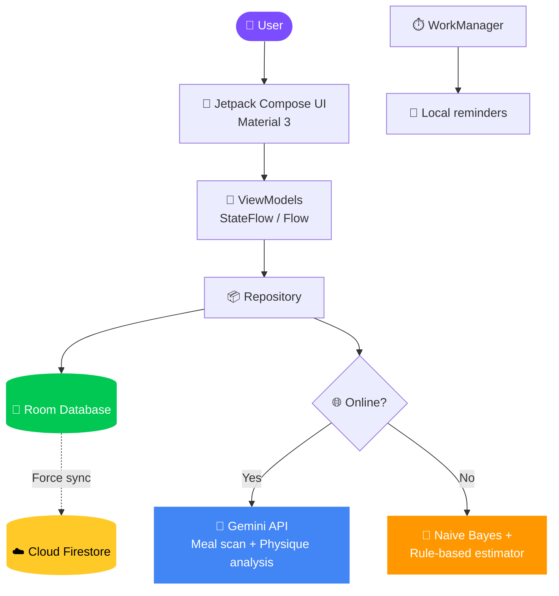

<div align="center">


<br/>


<br/>

**[📸 Screenshots](#-screenshots) · [🌟 Features](#-key-features) · [🛠 Tech Stack](#-tech-stack) · [🏗 Architecture](#-architecture) · [🚀 Getting Started](#-getting-started) · [🧪 CI/CD](#-cicd-workflows) · [🤝 Contributing](#-contributing)**

</div>

---

## 🎯 About

**EchoFit** is an advanced, AI-powered personal fitness and nutrition companion. It pairs a modern **Android app** for tracking and coaching with a sleek **web landing page**.

> 🧠 **Smart online, resilient offline.**
> The app uses the **Google Gemini API** for its visual meal scanner and physique comparison assessments. With no connection, it falls back automatically to an on-device **Naive Bayes text classifier** and a rule-based estimation engine.

---

## 📸 Screenshots

<div align="center">

| 📊 Dashboard | ⚙️ Settings |
| :---: | :---: |
|  |  |

</div>

---

## 🌟 Key Features

<table>
<tr>
<td width="50%" valign="top">

### 🍽️ AI Diet Planner & Calorie Vision Scanner
Snap or upload a meal photo and Gemini Vision estimates:
- Food name and portion size
- Calories, protein, carbs, fats, fiber

📴 **Offline mode:** falls back to high-quality local menu options when the cloud is unavailable.

</td>
<td width="50%" valign="top">

### 💪 AI Physique Transformation Assessments
Safely upload and compare progress photos (**Front, Side, Back**). Gemini compares before and after to produce:
- Visual body fat estimates
- Muscle toning analysis
- Motivational feedback

</td>
</tr>
<tr>
<td width="50%" valign="top">

### ✅ Daily Checklist & Gamification
Track **water intake, workouts, meal logs, and sleep**. Progress levels up your character (e.g. *Level 3 - Gym Warrior*) with gamified badges.

</td>
<td width="50%" valign="top">

### ⏰ WorkManager Reminder System
Automated local background alerts for **breakfast, lunch, snacks, dinner, and workouts**.

</td>
</tr>
<tr>
<td colspan="2" valign="top">

### ☁️ Firebase Cloud Sync
A force-sync feature pushes local Room database entities securely into **Firebase Cloud Firestore**.

</td>
</tr>
</table>

---

## 🛠 Tech Stack

<div align="center">


</div>

### 📱 Android Application (`/app`)

| Area | Technology |
| --- | --- |
| 🎨 **UI Framework** | Jetpack Compose & Material 3 (rich aesthetics, dark theme, glassmorphism cards) |
| 🧑‍💻 **Language** | Kotlin |
| 🏛️ **Architecture** | MVVM with Flow, StateFlow, and Repository patterns |
| 💾 **Persistence** | Room Database (local SQL) |
| ⚡ **Concurrency** | Kotlin Coroutines |
| ⏱️ **Background Work** | WorkManager (local notification and reminder scheduler) |
| 🔄 **Database Sync** | Cloud Firestore via Firebase SDK (syncs Room with cloud) |

**🤖 AI Engine**

| Mode | Details |
| --- | --- |
| 🌐 **Online** | Gemini API (Google Generative AI SDK) for calorie estimation from food images and physique photo diagnostics |
| 📴 **Offline fallback** | Custom **Naive Bayes classifier** running fully on-device to classify user queries, plus offline rule-based estimators |

### 💻 Web Landing Page (`/landing-page`)

| Area | Technology |
| --- | --- |
| ⚛️ **Framework** | React |
| ⚡ **Build System** | Vite |
| 🔷 **Language** | TypeScript |
| 🎨 **Styling** | Vanilla CSS |

---

## 🏗 Architecture



---

## 🚀 Getting Started

### 📱 Run the Android App

**Prerequisites**

- 🧰 Android Studio (Jellyfish 2024.1.1 or newer recommended)
- ☕ JDK 17
- 📱 Android SDK 34 (API level 34)

**Steps**

1. Open the project root directory in Android Studio.
2. Let Gradle synchronize dependencies.
3. Start an emulator or connect a physical device (e.g. `Pixel_7` AVD).
4. Run from Android Studio, or build and run from the CLI:

```bash
./gradlew assembleDebug

# Deploy and run via CLI
android run --apks=app/build/outputs/apk/debug/app-debug.apk --device=emulator-5554
```

### 💻 Run the Landing Page

**Prerequisites**

- 🟢 Node.js v18 or newer
- 📦 npm or yarn

**Steps**

```bash
# 1. Go to the landing page folder
cd landing-page

# 2. Install dependencies
npm install

# 3. Start the dev server
npm run dev
```

Then open **http://localhost:5173** in your browser.

---

## 🧪 CI/CD Workflows

Pre-configured **GitHub Actions** workflows live in `.github/workflows/`:

| Workflow | What it does |
| --- | --- |
| 🤖 **Android CI** | Runs compilation checks on every pull request or push to `main` |
| 🌐 **Web Landing Page CI** | Installs Node dependencies and runs build tests to prevent breaking the website |

---

## 🤝 Contributing

Contributions are welcome!

1. 🍴 Fork the project
2. 🌿 Create your feature branch: `git checkout -b feature/AmazingFeature`
3. 💾 Commit your changes: `git commit -m 'Add some AmazingFeature'`
4. 📤 Push to the branch: `git push origin feature/AmazingFeature`
5. 🔀 Open a pull request

---

## 📄 License

Distributed under the **MIT License**. See `LICENSE` for more information.

---

<div align="center">

### 👤 Author

**Mahesh S**

[](https://github.com/Mahesh-011-vk)
[](https://linkedin.com/in/mahesh-s-318367203)

<br/>

⭐ **If EchoFit helps you, give it a star!** ⭐


</div>
